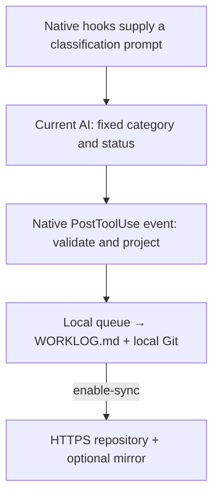

# I-m-Genius

[中文](README.zh-CN.md) · [Privacy and data boundaries](PRIVACY.md) · [MIT License](LICENSE)

**Your work with AI deserves a record.**

Research, planning, long conversations and debugging all take effort. Much of it never becomes a shipped feature or a repository: small experiments may stay unversioned, private projects may stay off public hosts, and work can be spread across tools and hosting platforms. A contribution graph captures only part of that story.

I-m-Genius helps you recognize that work. It gathers progress reported by the AI into one local Markdown journal with real Git history, so you can look back on the effort you put in without publishing your working projects' code.

**v0.2.0 is a Windows x64 preview for Codex and Claude Code.** [Quick install](#quick-install-windows-x64) · [Build from source](#1-clone-and-build). Recording depends on the AI making a valid classification call; an entry for every conversation is not guaranteed.

**Runtime fixes on `main`:** startup recovery, faster history checks and local health diagnostics were updated on October 28, 2026. The published v0.2.0 ZIP predates these fixes; use the [source installation](#1-clone-and-build) for the updated runtime.

## Why use it?

- **Lightweight capture.** Native client hooks and a small local worker fit into your existing workflow. The AI already working on your task chooses a fixed category and status; there is no separate AI summarizer.
- **A small, consistent journal.** Entries contain UTC time, category, status and a daily badge. No conversation body, project name, chat title or free-text summary goes into the journal. **I-m-Genius promises not to save or upload conversation content or the private information it contains anywhere.** If you still have concerns, you can quickly verify this in the [lightweight, readable source code](src).
- **Local first, sharing by choice.** A local queue feeds `WORKLOG.md` and real Git commits. Journal upload starts only after you explicitly enable it.
- **History you can inspect.** Preview the full journal, changes and Git identity. Audited history can go to one HTTPS Git repository and one optional mirror, with independent retries for each destination.

## How it works



Hooks can briefly receive raw prompt text; capture discards it and never opens transcript files. Original client configuration backups stay local and may contain sensitive settings. **Git upload also sends names, email addresses, times and other metadata; a public journal exposes them.** These limits are not an absolute privacy or security guarantee. Read [PRIVACY.md](PRIVACY.md) before enabling upload.

A journal entry looks like this:

| 时间（UTC） | 类别 | 状态 | 进度 |
| --- | --- | --- | --- |
| 2026-10-12 08:15:30 | 实现 | 进行中 | 1 commit! smart! |
| 2026-10-12 08:26:12 | 验证 | AI报告完成 | 2 commit! smart! |

The current journal headings and category/status labels are Chinese. `N commit!` counts **new state rows on that UTC date**, not Git commits. Several rows processed in one batch can share a real Git commit. The count does not measure code quality or hours worked. “AI报告完成” means the AI reports completion.

## Quick install (Windows x64)

1. Download **`I-m-Genius-0.2.0-windows-x64.zip`** from the [v0.2.0 release](https://github.com/cdzdd/I-m-Genius/releases/tag/v0.2.0), choose **Extract All**, then double-click **`Install.cmd`** in the extracted folder. Windows may warn about an unsigned download.
2. The wizard detects supported Codex / Claude Code installations. Select at least one client to connect, review the prefilled Git name and email, and enter a **new, separate, empty HTTPS journal repository** and optional empty mirror. Install is disabled when no supported client is detected. Never enter a password or token in the form or URL. Do not use this project's source repository or a work project as the journal destination.
3. Local recording is the default. Leave **Enable automatic upload (opens Git authentication)** unchecked to try it locally, or explicitly select it to authorize future journal uploads. Git's normal credential helper may then open a browser or prompt for authentication; the installer has no token field.
4. Restart/reload your AI clients and confirm their normal MCP/workspace trust and hook permissions. Complete a small task in a new chat, then inspect status and the journal. Recording depends on a valid AI classification call and cannot guarantee an entry for every conversation.

The ZIP bundles Node.js **22.23.3** and locked production dependencies. You do not need to install Node/npm, run a build, or compile a startup launcher. Git for Windows is still required at `C:/Program Files/Git/cmd/git.exe`; if missing, the wizard offers **Download Git**, opening the [official Git for Windows download page](https://git-scm.com/downloads/win). Install Git, then rerun the installer. Windows PowerShell **5.1**, WinForms and the system .NET Framework are required. No administrator privileges are required for I-m-Genius.

`Install.cmd` uses `ExecutionPolicy Bypass` only for its PowerShell process; it does not persistently change execution policy or override organizational policy. The readable installer scripts check prerequisites, regular files and bundled SHA-256 hashes, and refuse unknown existing program/data directories or conflicting hooks. The hash manifest detects corruption; it is not a cryptographic signature and cannot authenticate a modified archive together with its manifest.

The permanent program directory is `%LOCALAPPDATA%/Programs/I-m-Genius` (`payload/node.exe` and `payload/app`); private data defaults to `%LOCALAPPDATA%/WhatIveDone`. Hooks and startup use the permanent copy, never the temporary extraction directory. The wizard captures the CLI's exact canonical **`configPath`** in the program directory's **`install-receipt.json`**: Windows packaged-app redirection can change the physical location. **Open journal** opens that private directory in Explorer. For later CLI management, use the saved path. Do not move the installed program or private data.

After successful initialization, open **I-m-Genius** in the Windows Start menu to return to the installed wizard; the extracted ZIP directory is no longer needed. If Windows prevents shortcut creation, run `%LOCALAPPDATA%/Programs/I-m-Genius/Install.cmd` directly.

Reopening a completed local installation lets you explicitly select automatic upload and click **Enable upload**. The existing repository, mirror and Git identity remain read-only; this does not copy or initialize again, or add a new mirror. If requested upload enablement failed after initialization, local recording remains active and **Retry upload** is available while still local. Existing automatic-upload installations let you open the journal directory. The installer does not uninstall your profile. This preview does not promise an in-place upgrade or automatic repair after a partial copy/initialization failure; it stops for manual review. Use the source instructions below only when choosing a source installation.

For later CLI commands with a ZIP installation, replace `node .\dist\src\cli.js` in the source examples with this prefix, and set `$config` to your saved canonical path:

```powershell
& "$env:LOCALAPPDATA/Programs/I-m-Genius/payload/node.exe" "$env:LOCALAPPDATA/Programs/I-m-Genius/payload/app/dist/src/cli.js" status --config $config
```

Read [Privacy and data boundaries](PRIVACY.md) before enabling upload. Git uploads include your configured name/email and commit metadata. The journal's existing Chinese labels and UTC times are shown above.

## Source installation requirements

- Windows x64, Node.js with npm, and Git for Windows. The development environment uses Node.js **22.14.0** and Git **2.49.0.windows.1**; other environments have not been fully qualified.
- Git at `C:/Program Files/Git/cmd/git.exe`. This preview does not choose an arbitrary Git executable from PATH.
- Codex and/or Claude Code installed, authenticated and working. Supported entry discovery is described [below](#support-and-limitations).
- Source installation's automatic background startup uses the Windows .NET Framework compiler at `%SystemRoot%/Microsoft.NET/Framework64/v4.0.30319/csc.exe`. It builds a small launcher locally, without downloading a launcher. Use manual mode if the compiler is unavailable. The prebuilt ZIP already includes the launcher.
- A **new, separate, empty journal repository** on GitHub, Gitee, GitLab or another HTTPS Git host. Do not initialize a README, license or `.gitignore`. A private repository is supported. An optional mirror must also be empty and have a different URL.

**`cdzdd/I-m-Genius` is the project's source repository. Do not use it, or your work project's repository, as the journal destination.** This preview supports a new empty journal, one writing computer, and the fixed `main` branch. It does not import existing project or journal history.

Use an HTTPS destination such as `https://github.com/YOUR_NAME/my-ai-data.git`. Upload uses normal Git credential management. Ensure ordinary Git authentication works for your repository. Do not put passwords or tokens in URLs, commands or chat messages.

## 1. Clone and build

Run in a regular PowerShell session; administrator privileges are not required:

```powershell
New-Item -ItemType Directory -Path C:/AI -Force | Out-Null
git clone https://github.com/cdzdd/I-m-Genius.git C:/AI/I-m-Genius
Set-Location C:/AI/I-m-Genius
npm ci
npm run build
```

These instructions install from the source checkout; no npm install package is published. `npm ci` downloads the locked dependencies. After installation, keep the source directory, Node executable and private data directory in place: client hooks and the startup task store absolute paths.

## 2. Initialize and connect the clients

Replace the destination, Git name and email. The email becomes Git history metadata. If you want a noreply address, copy the complete address displayed in your hosting account's email settings.

```powershell
$config = 'C:/AI/I-m-Genius-data/config.json'
node .\dist\src\cli.js init --config $config --repo https://github.com/YOUR_NAME/my-ai-data.git --name 'YOUR_NAME' --email 'YOUR_GIT_EMAIL' --source codex --source claude
```

Remove one `--source` if you only use one client. Initialization merges three owned hooks and registers a stdio MCP server named `whativedone`, preserving existing client configuration and keeping original configuration backups in the private data directory. It does not change accounts, select a model or grant client trust for you.

The private directory must be absent or empty and separate from the source checkout. Successful initialization prints `configPath`. Set `$config` to that **exact printed path** for all later commands: Windows packaged-app filesystem redirection can change the physical location. Do not rerun `init` on an existing installation.

The initial mode is `local`: this project's journal Git network operations are disabled. By default, initialization installs a current-user logon task and starts the worker immediately without a terminal window. It waits 60 seconds after processing each batch, runs without elevation, and requires a logged-in user. Processing and network time add to this interval.

After a quick reboot, the worker waits for an abandoned lock to expire instead of silently skipping startup. Duplicate starts wait for an advancing heartbeat (normally within 10 seconds) before reporting an existing worker; a failed start has a 130-second retry limit. History checks batch Git-object reads and reuse immutable, validated results within one processing batch. Later batches re-read history when an audit is needed; no persistent trust cache is created.

For manual processing, append `--no-startup` to `init`, then keep this command running while you want the journal updated:

```powershell
node .\dist\src\cli.js sync --watch --config $config
```

Closing this manual window stops processing. Events captured by the hooks remain queued locally.

## 3. Test locally

Restart Codex, reload the editor window using Claude Code, or reopen Claude Code CLI to reconnect the MCP server. Grant MCP/workspace trust and hook permission through the clients' normal flows. Codex native hook trust requires confirmation in Codex; installation does not bypass it.

Complete a small task with meaningful progress in a new chat. The AI should call `mcp__whativedone__classify_progress` with only category and status. Wait about a minute, then inspect:

```powershell
node .\dist\src\cli.js status --config $config
node .\dist\src\cli.js preview --config $config
```

The journal is `repository/WORKLOG.md` under the printed configuration directory. It may not exist until the first valid classification. `preview` shows pending local Git commits, full journal content, patches and Git identity. It does not contact the network or drain the queue. In manual mode, run `sync --config $config` once first if needed.

Recording depends on the AI making the classification tool call; a record for every chat is not guaranteed. Repeated identical category/status values within a turn do not append another row. `none/unknown` stays local. There is no transcript scan or assumption that a stopped task is completed.

## 4. Review and enable upload

Review preview and your Git email, then run:

```powershell
node .\dist\src\cli.js enable-sync --config $config
```

To upload to a second host, use this **instead, during first enablement**:

```powershell
node .\dist\src\cli.js enable-sync --config $config --mirror https://gitee.com/YOUR_NAME/my-ai-data.git
```

`init` also accepts `--mirror` while remaining local. Choose both destinations before first enablement: adding a new mirror after the primary contains journal history is not supported.

`enable-sync` displays the targets, branch and Git identity, checks every destination is empty, and saves authorization for future rule-based batches. It does not ask for approval per row. Both hosts receive the same audited history. Authentication or network failure at one destination is retried independently and does not block local recording or the healthy destination. Unknown remote history or manual journal changes block publication instead of forcing an overwrite. No force push is used.

If initial authentication needs a browser or prompt, explicitly run `enable-sync --config $config --interactive-auth` (include `--mirror` when needed at first enablement). Only allowlisted normal Git credential helpers may interact; background processing remains noninteractive. Helpers can contact authentication services beyond the journal host. Never paste credentials into the installer, URLs or chat.

The source checkout and journal repository are separate. Work project files, raw conversations and client configuration backups are excluded from the journal repository. **A push also transmits Git author/committer names, email addresses, times, fixed commit messages and Git object metadata.** Read [PRIVACY.md](PRIVACY.md) for the exact boundaries.

## Daily labels

Times use UTC in `YYYY-MM-DD HH:MM:SS` format. Categories are research / planning / implementation / verification / debugging; statuses are in progress / waiting for input / blocked / AI-reported done. The Chinese labels are shown in the journal.

Each UTC date starts at one. The label advances after each group of 20 rows. Counts continue without a cap; the last label stays the same:

| Daily state rows | Label |
| --- | --- |
| 1–20 | smart! |
| 21–40 | clever! |
| 41–60 | intelligent! |
| 61–80 | brilliant! |
| 81–100 | genius! |
| 101–120 | true genius! |
| 121–140 | super genius! |
| 141+ | absolute incredible genius! |

## Manage, upgrade and uninstall

Run these from the source directory, using the exact saved `$config` path:

```powershell
node .\dist\src\cli.js status --config $config
node .\dist\src\cli.js pause --config $config
node .\dist\src\cli.js resume --config $config
node .\dist\src\cli.js start --config $config
node .\dist\src\cli.js uninstall --config $config
```

- `pause` stops new capture and publication; an in-flight batch can finish. `resume` restores capture and requests revalidation of errors, without repairing invalid history.
- `start` runs the already installed background task. An active worker is not duplicated. For manual mode, use `sync --watch`.
- `uninstall` disables capture and removes matching owned hooks, MCP registration and the logon task. It **retains journal history, configuration and backups**. Modified third-party registrations are not blindly removed. Keep `CODEX_HOME` / `CLAUDE_CONFIG_DIR` unchanged until uninstall finishes.

For a **source installation** upgrade, pause first. Keep all installation paths unchanged and update the source/build:

```powershell
node .\dist\src\cli.js pause --config $config
git pull --ff-only
npm ci
npm run build
```

Then sign out of Windows and sign back in, or restart Windows, so the old worker and MCP processes exit. The logon task loads the new build while capture remains paused. Reopen PowerShell in `C:/AI/I-m-Genius`, set `$config` to the saved physical path again, and run:

```powershell
node .\dist\src\cli.js resume --config $config
node .\dist\src\cli.js start --config $config
```

Reconnect/reload the AI clients afterward. Do not initialize again or manually edit journal content, Git history or upload destinations. Valid older display formats upgrade deterministically on subsequent progress, retaining original times/categories/statuses and historical commits.

## Support and limitations

This preview is Windows-only. Compatibility development uses Codex CLI **0.162.0** and Claude Code **2.1.295**. The author has observed recording in Codex desktop and real GitHub/Gitee dual-destination synchronization on their computer. This does not qualify every client version, installation layout or editor entry.

- Codex registration first recognizes `%LOCALAPPDATA%/Programs/OpenAI/Codex/bin/codex.exe`, otherwise the exact `bin/codex.js` entry in `%APPDATA%/npm/node_modules/@openai/codex`. Other standalone installer layouts or custom npm prefixes are unsupported. Configuration uses `CODEX_HOME`, or `~/.codex`, merging `hooks.json` and `config.toml`.
- Claude registration recognizes exact `cli.js` or `bin/claude.exe` entries in `%APPDATA%/npm/node_modules/@anthropic-ai/claude-code`. Configuration uses `CLAUDE_CONFIG_DIR`, or `~/.claude/settings.json` and `~/.claude.json`; a custom directory uses its `.claude.json`.
- Editor extensions require shared supported configuration and the expected native event/MCP fields. Claude Code VS Code still requires a local user test. Codex IDE, other AI tools, macOS/Linux, other Claude installation layouts, and Cowork/staging profiles are outside this preview's supported scope.
- Missing native session/turn IDs, failed results and unknown result wrappers fail closed. There is no transcript fallback. Integration status `configured_unverified` means configuration was installed and a local client test is required.
- There is no chat lookup, work project backup, free-text summary, or automatic backfill of missed chats. Contribution graph display depends on the Git host's own rules.

## Troubleshooting and audit

Check `captureEnabled`, `queuedCount`, `oldestQueuedAt`, `unclassifiedCount`, `errorCode` and per-target status in `status`. `watcher.state` reports `active` for a lock heartbeat seen within 120 seconds, `stale` for an older lock, `stopped` when no lock exists, or `unknown` when it cannot be checked. A fresh heartbeat is evidence of recent worker activity, not an independent process-health guarantee. `lastRun` reports the latest batch's start/end times, duration in milliseconds and fixed result; `processing` has no end time yet. Older profiles have `lastRun: null` until their first run with this version. An unavailable or invalid diagnostic file sets `runHealthError: "unavailable"`; a diagnostic write failure warns `diagnostics_unavailable` without blocking progress processing.

A queue that is not being processed suggests checking the heartbeat and last run, running `start`, or a one-shot `sync`. An empty queue with increasing unclassified turns suggests checking MCP availability, hook permission and classification tool calls in the client. Unclassified turns are not necessarily lost meaningful work and are never reconstructed from conversations. Diagnostic timestamps and fixed results stay in private `run-health.json` and are not uploaded.

Do not publish raw chats, original configuration backups, secrets or tokens when reporting an issue. Client entry/version, fixed error codes, whether the classification tool appeared, and whether WORKLOG exists are enough to start diagnosis.

Runtime production logic is kept in seven readable modules. Runtime subprocess execution is in [`src/transport.ts`](src/transport.ts):

| Module | Responsibility |
| --- | --- |
| `schema.ts` | Fixed fields, journal formatting and content validation |
| `mcp.ts` | Category/status classification tool |
| `capture.ts` | Native event projection and hook output |
| `store.ts` | Private queue, state and locks |
| `transport.ts` | Git, credential settings, client registration, ACL and startup |
| `publish.ts` | Local transactions, history audit and independent retries |
| `cli.ts` | Initialization and management commands |

The fixed GUI launcher's C# source is embedded in `transport.ts` and saved locally as `startup-launcher.cs` when compiled. Review it alongside the TypeScript: it only starts Node without a console, waits and returns the exit code. The ZIP's PowerShell/command installer scripts are also readable; their local installation work is separate from the runtime's seven modules. Packaging downloads the official pinned-hash Node release and locked npm dependencies; installed users use the bundled copies.

Contributors can run `npm ci` and `npm test` from a source checkout. Tests cover fixed classifications, native JSON contracts, privacy boundaries, real local Git, dual-target failure recovery and startup definitions. Test doubles do not establish compatibility with every real client or hosting service.
