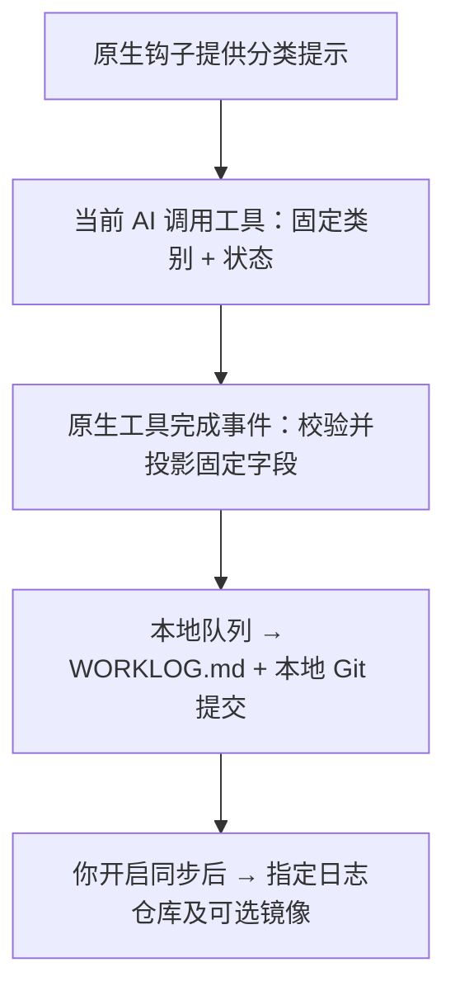

# I-m-Genius

[English](README.md) · [隐私与上传边界](PRIVACY.md) · [MIT License](LICENSE)

**让你和 AI 的努力，被看见。**

I-m-Genius 是一个轻量、自动、可审查的 AI 工作日志工具。把 Codex、Claude Code 中的开发进展汇总到一个 `WORKLOG.md`，用每日计数和成就称号回顾你与 AI 推进工作的过程。无需为每个小项目建立仓库，也无需上传项目代码或对话正文。

**当前为 Windows 预览版，接入 Codex 和 Claude Code。** [开始安装](#安装前准备) · [了解记录链路](#记录链路清晰可见)

## 提交记录之外，还有很多努力

你可能每天在多个 AI 工具里进行大量对话：调研思路、尝试实现、排查问题、反复验证。但这些投入未必出现在仓库的贡献图上：

- 有些探索最终没有形成可发布的产出，却帮你验证了方案、排除了错误方向。
- 有些工作只发生在本地小项目或私有项目中，你没有时间为它们建仓库、维护版本，或不方便公开代码。
- 有些项目只在 GitHub 或 Gitee 的一个平台维护，加上工作散落在不同工具中，单个平台的提交记录难以呈现你的全部投入。

I-m-Genius 为这些过程留下简洁、可回顾的进展记录。调研、方案、实现、验证、排障都可以成为一天里的一个足迹；每日递增的计数和称号，让你看见自己的积累，也获得一点完成工作的成就感。

**探索值得记录，努力值得认可。** 日志记录的是已报告的进展；贡献图是否显示提交仍由托管平台的规则决定。

## 轻量记录，隐私边界明确

| 特点 | 你得到什么 |
| --- | --- |
| 对话正文不保存、不上传 | 不扫描历史对话文件；原始对话、工具输出和项目路径不会写入进展队列或日志仓库。**本项目承诺不会在任何地方保存或上传对话的具体内容及其中的隐私信息；**若仍有疑虑，可在[轻量、可读的源码](src)中快速核查。 |
| 原生钩子 + 固定字段 | 由当前工作的 AI 选择预定义类别与状态；没有可把对话带出去的自由文本摘要字段。 |
| 轻量、方便审查 | 生产逻辑集中在七个可读模块，无需额外接入 AI 摘要服务；联网和子进程入口集中在一个文件中。 |
| 配置后后台记录 | 原生事件捕获后，本地后台约每分钟处理一次；有效分类自动追加到同一个 Markdown 日志，减少手工整理。 |
| 同步由你开启 | 默认只在本地记录，上传前可预览完整内容；开启后可同步到一个日志仓库及一个镜像，例如 GitHub + Gitee。 |

## 记录链路清晰可见



[`capture.ts`](src/capture.ts) 处理原生事件，[`mcp.ts`](src/mcp.ts) 只接受固定分类，[`publish.ts`](src/publish.ts) 生成并审查日志历史，[`transport.ts`](src/transport.ts) 集中管理 Git 上传。上传目标、待发送内容和发送结果都可以在本地查看；从事件到记录再到同步，代码和数据边界均可审查。

**上传的日志行只包含 UTC 时间、预定义类别、预定义状态，以及由当日条数生成的计数和固定称号。** 不包含对话正文、自由文本摘要、项目代码、路径或原始会话标识。

隐私边界也公开说明：原生钩子输入可能短暂包含对话原文，程序解析后丢弃，不保留或上传；初始化会在本机备份原客户端配置；Git 同步会附带你配置的姓名、邮箱和提交元数据。可使用私有日志仓库和平台提供的 noreply 邮箱。具体保存内容、联网入口及审查方法见 [PRIVACY.md](PRIVACY.md)。

## 每天的进展，一眼可见

| 时间（UTC） | 类别 | 状态 | 进度 |
| --- | --- | --- | --- |
| 2026-10-12 08:15:30 | 实现 | 进行中 | 1 commit! smart! |
| 2026-10-12 08:26:12 | 验证 | AI报告完成 | 2 commit! smart! |

这里的 `N commit!` 计数是**当天新增的状态记录数**。后台约每分钟处理一批，多条状态可能合为一个真实 Git 提交；它不是 Git 提交数量，也不衡量代码质量或工作时长。`AI报告完成` 是 AI 的声明。

## 安装前准备

- Windows x64、Node.js 和 npm、Git for Windows。开发验证环境为 Node.js **22.14.0**、Git **2.49.0.windows.1**；其他环境尚未完整验证。
- Git 必须位于 `C:/Program Files/Git/cmd/git.exe`。这版不从任意 PATH 中选择 Git。
- 要接入的 Codex 和／或 Claude Code 已安装、登录并能正常使用。具体安装位置和兼容范围见[下方说明](#支持范围与限制)。
- 默认后台启动需要系统自带的 `%SystemRoot%/Microsoft.NET/Framework64/v4.0.30319/csc.exe`，用于在本机编译一个小启动器；不下载启动器。缺少此文件时可以选择手动模式。
- 在 GitHub、Gitee、GitLab 等服务中，**新建独立的空日志仓库**：不要初始化 README、许可证或 `.gitignore`。可选择私有仓库。可选镜像也必须为空，且 URL 与主仓库不同。

**本仓库 `cdzdd/I-m-Genius` 是项目源码仓库。不要将它或你的工作项目用作日志目标。** 当前版本只支持新建空日志仓库、一个写入设备和固定 `main` 分支，不导入已有项目或已有日志历史。

准备日志仓库的 HTTPS 地址，例如 `https://github.com/YOUR_NAME/my-ai-data.git`。上传使用 Git 的正常凭据管理；请先确保你能通过正常 Git 登录流程访问仓库，不要把密码或 token 写入 URL、命令示例或对话。

## 1. 下载并构建

在普通 PowerShell 中运行，不需要以管理员身份启动：

```powershell
New-Item -ItemType Directory -Path C:/AI -Force | Out-Null
git clone https://github.com/cdzdd/I-m-Genius.git C:/AI/I-m-Genius
Set-Location C:/AI/I-m-Genius
npm ci
npm run build
```

这是从源码安装。依赖由锁文件确定，尚未发布 npm 安装包；`npm ci` 会联网下载依赖。安装后不要移动源码目录、Node 程序或数据目录，钩子和后台任务会保存其绝对路径。

## 2. 初始化并接入 AI 工具

替换下面的仓库、Git 姓名和邮箱。邮箱会进入 Git 历史；需要隐藏个人邮箱时，使用托管平台邮箱设置中显示的完整 noreply 地址。

```powershell
$config = 'C:/AI/I-m-Genius-data/config.json'
node .\dist\src\cli.js init --config $config --repo https://github.com/YOUR_NAME/my-ai-data.git --name 'YOUR_NAME' --email 'YOUR_GIT_EMAIL' --source codex --source claude
```

只使用一个工具时，去掉另一个 `--source`。初始化会合并本项目的三类钩子和名为 `whativedone` 的 MCP 服务，保留已有客户端配置，并在私有数据目录保留原配置备份。不会切换模型、修改账号或替你授予客户端信任。

`I-m-Genius-data` 必须不存在或为空，且应与源码目录分开。命令成功会打印 `configPath`；请将 `$config` 改为**打印出的实际路径**，后续命令继续使用它。Windows 打包应用的文件重定向可能使该路径与输入值不同。不要对已存在的安装重新执行 `init`。

初始模式为 `local`，此时本项目不执行日志仓库的 Git 网络操作。默认安装当前用户的登录启动任务，立即启动无终端窗口的后台处理程序，之后每约 60 秒处理一次队列。它以普通用户权限运行，只有登录后才运行。

如果不需要自动后台处理，在初始化命令末尾添加 `--no-startup`，然后在需要记录时保持下面的窗口运行；该窗口关闭后会停止处理，钩子取得的事件仍在本地等待：

```powershell
node .\dist\src\cli.js sync --watch --config $config
```

## 3. 在本地试用

重启 Codex、重新加载使用 Claude Code 的编辑器窗口，或重开 Claude Code CLI，让 MCP 服务重新连接。通过客户端的正常流程确认 MCP／工作区信任和钩子许可；Codex 的原生钩子信任需要在客户端中确认，安装程序不会绕过。

在新对话中完成一个有实际进展的小任务。正常情况下，AI 会调用 `mcp__whativedone__classify_progress`，只传入类别和状态。等待约一分钟后查看：

```powershell
node .\dist\src\cli.js status --config $config
node .\dist\src\cli.js preview --config $config
```

日志位于打印出的配置目录下的 `repository/WORKLOG.md`。首次取得有效分类前，该文件可以尚未生成。`preview` 显示待上传的本地 Git 提交、完整日志、修改内容和 Git 身份；它不联网，也不处理队列。手动模式下可先运行一次 `sync --config $config`。

AI 分类依赖工具调用，不能保证每个对话都会记录。同一轮重复报告相同类别／状态不会重复追加；`none/unknown` 只在本地处理，不写入日志。不扫描历史对话，也不根据停止事件猜测已完成。

## 4. 检查后开启上传

确认预览中的内容和 Git 邮箱符合你的预期，再执行：

```powershell
node .\dist\src\cli.js enable-sync --config $config
```

需要同时写入另一服务时，在**首次开启上传**时使用下面的命令代替上面的命令：

```powershell
node .\dist\src\cli.js enable-sync --config $config --mirror https://gitee.com/YOUR_NAME/my-ai-data.git
```

也可以在 `init` 时指定 `--mirror`，初始状态仍为本地模式。请在首次开启上传时确定全部目标：目前不支持向已经有日志的主目标追加一个新镜像。

`enable-sync` 会显示目标、分支和 Git 身份，联网检查所有目标为空，再保存未来批次的上传授权。此后无需逐条确认；后台会把同一份审核过的历史上传到两处。一处断网或认证失败时独立重试，不影响本地记录和另一处；不强制推送。仓库出现未知历史或内容被手动修改时，会拒绝上传并显示固定错误。

源码仓库和日志仓库相互独立；工作项目文件、原始对话、应用配置备份不会加入日志仓库。**实际上传还包含 Git 作者／提交者姓名、邮箱、时间、固定提交信息及 Git 对象元数据**，详情见 [PRIVACY.md](PRIVACY.md)。

## 每日计数

时间为 UTC，显示格式为 `YYYY-MM-DD HH:MM:SS`。类别为调研／方案／实现／验证／排障；状态为进行中／等待输入／受阻／AI报告完成。

计数按 UTC 日期重新从 1 开始，每 20 条更换一个固定称号，最后一档不再变化，数字继续增长：

| 当天状态数 | 称号 |
| --- | --- |
| 1–20 | smart! |
| 21–40 | clever! |
| 41–60 | intelligent! |
| 61–80 | brilliant! |
| 81–100 | genius! |
| 101–120 | true genius! |
| 121–140 | super genius! |
| 141+ | absolute incredible genius! |

## 管理、升级与卸载

以下命令均在源码目录执行，并继续使用初始化打印的 `$config`：

```powershell
node .\dist\src\cli.js status --config $config
node .\dist\src\cli.js pause --config $config
node .\dist\src\cli.js resume --config $config
node .\dist\src\cli.js start --config $config
node .\dist\src\cli.js uninstall --config $config
```

- `pause` 停止新捕获和上传，已开始的批次可能完成；`resume` 恢复并重新检查出错状态，不修复违规历史。
- `start` 启动已安装的后台任务；已运行时不会创建第二个记录进程。手动模式请使用 `sync --watch`。
- `uninstall` 关闭捕获，移除匹配的本项目钩子、MCP 注册和登录任务，**保留日志、配置和备份**；对已被别人修改的注册不会盲目删除。不要在卸载前改变 `CODEX_HOME` 或 `CLAUDE_CONFIG_DIR`。

升级时先暂停，保持原目录更新源码和构建：

```powershell
node .\dist\src\cli.js pause --config $config
git pull --ff-only
npm ci
npm run build
```

随后退出 Windows 登录并重新登录，或重启 Windows，让旧 Node／MCP 进程退出。登录任务会加载新构建，此时捕获仍暂停。重新打开 PowerShell，进入 `C:/AI/I-m-Genius`，将 `$config` 重新设置为保存的实际路径，再运行：

```powershell
node .\dist\src\cli.js resume --config $config
node .\dist\src\cli.js start --config $config
```

最后重启／重新加载 AI 客户端。不要重新初始化，也不要手动更改日志、Git 历史或上传目标；旧格式的合法日志会在后续记录中自动进行固定的显示升级，保留原始时间／类别／状态和历史提交。

## 支持范围与限制

当前只支持 Windows，兼容验证环境为 Codex CLI **0.162.0** 和 Claude Code **2.1.295**。作者已在本机使用 Codex 桌面端完成记录，并完成 GitHub／Gitee 双目标同步；这不表示所有客户端版本、安装方式或编辑器入口都已验证。

- Codex 注册器先识别 `%LOCALAPPDATA%/Programs/OpenAI/Codex/bin/codex.exe`，否则识别 `%APPDATA%/npm/node_modules/@openai/codex` 中明确的 `bin/codex.js` 入口。读取 `CODEX_HOME`，否则使用 `~/.codex`，合并 `hooks.json` 和 `config.toml`。其他独立安装器或自定义 npm 前缀尚不支持。
- Claude 注册器识别标准全局 npm 目录 `%APPDATA%/npm/node_modules/@anthropic-ai/claude-code` 中明确的 `cli.js` 或 `bin/claude.exe` 入口。读取 `CLAUDE_CONFIG_DIR`，否则使用 `~/.claude` 的 `settings.json` 与 `~/.claude.json`；自定义目录使用其中的 `.claude.json`。
- 编辑器扩展只有在共享受支持配置、提供所需原生事件和 MCP 字段时才可记录；Claude Code VS Code 入口仍需使用者本机复测。Codex IDE、其他 AI 工具、macOS／Linux、Claude 的其他安装位置及 Cowork／staging 配置不在这版保证范围内。
- 缺少原生会话／轮次 ID、不成功的工具返回、未知包装格式都会拒绝记录，不回读对话补全。安装状态显示 `configured_unverified`，代表已配置，需要你做本机试用。
- 不提供对话索引、项目代码备份、自由文本摘要、自动补写漏记对话。GitHub 等平台是否显示贡献由其自身规则决定。

## 排障与审查

没有记录时先检查 `status` 的 `captureEnabled`、`queuedCount`、`unclassifiedCount`、`errorCode` 和各目标状态。队列有数据但不处理时，检查后台任务，运行 `start` 或一次 `sync`；队列为空且未分类数增长时，检查客户端是否加载 MCP、许可钩子并调用分类工具。

不要为排障公开原始对话、配置备份、密钥或 token。可报告客户端入口／版本、固定错误码、是否出现分类工具调用以及是否存在日志文件。

项目生产逻辑集中在七个可读模块，所有子进程执行集中于 [`src/transport.ts`](src/transport.ts)：

| 文件 | 用途 |
| --- | --- |
| `schema.ts` | 固定字段、日志格式和上传内容校验 |
| `mcp.ts` | 只接受类别与状态的分类工具 |
| `capture.ts` | 原生输入投影与钩子返回 |
| `store.ts` | 私有队列、状态和锁 |
| `transport.ts` | Git、凭据配置检查、客户端注册、权限与后台任务 |
| `publish.ts` | 本地事务、历史审查及目标重试 |
| `cli.ts` | 初始化和管理命令 |

后台 GUI 启动器的固定 C# 源码嵌在 `transport.ts`，本地编译时保存为私有目录的 `startup-launcher.cs`，可一并审查。它只负责无窗口启动 Node、等待退出并返回退出码。

开发者可从锁文件运行 `npm ci` 和 `npm test`。测试覆盖固定分类、原生 JSON 协议、隐私边界、真实本地 Git、双目标失败恢复和后台启动定义；自动化替身测试不等于所有真实客户端与服务均已验证。
